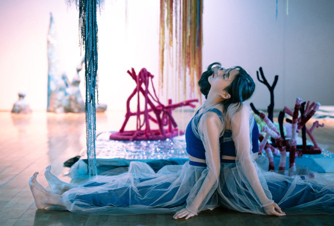

Blue's Blues was selected through the 3rd Bupyeong Emerging Curator open call organized by the Bupyeong-gu Foundation for Culture, with support worth approximately 25 million KRW. I planned and ran the exhibition as its overall curator, in collaboration between choreographer Cha Minyoung and artist Choi Kyungwon.

## Curatorial statement

We turn our attention to blue: the blue of the vital sea; the blue of jeans, at once the workers' garment and a representative fashion item of the age of consumer capitalism; and the blue that portrays anxiety and melancholy. Blue is a color that shines clear and at the same time symbolizes depression. It is the representative color of the sea, and also the color of indigo dye, which causes the largest ecological problem among clothing dyes.

We judged that a strategy of overlapping the blue of the sea with the blue of jeans, an icon of contemporary fashion, to create an irony of color is the most effective artistic means of making visible the marine ecological problems of fast fashion. For this reason we name the exhibition Blue's Blues, a name in which blue is inscribed twice.

Completed through the collaboration of choreographer Cha Minyoung and artist Choi Kyungwon, the exhibition 《Blue's Blues》 conveys the ecological problems caused by clothing culture to the viewer's skin, through the waves produced by the moving body and the still body, the outer skin and the interior of the body, and the future and the traces of the body.

## 기획의 글

우리는 블루에 주목한다. 생명력 넘치는 바다의 색 블루, 노동자의 작업복인 동시에, 소비자본주의 시대의 대표적 패션 아이템인 청바지의 블루, 그리고 불안과 멜랑콜리를 그려내는 블루에 주목한다. 블루는 청아하게 빛나는 동시에 우울을 상징하는 색이며, 바다를 대표하는 색인 동시에 의복 염료 중 가장 큰 생태계 문제를 야기하는 인디고 염료의 색이기도 하다. 우리는 바다의 파랑과 현대패션 아이콘인 청바지의 파랑을 중첩시켜 색채의 아이러니를 만들어내는 전략이, 패스트 패션의 해양 생태계 문제를 가시화하는 가장 효과적인 미술적 방법이라는 판단 하에, 본 전시의 이름을, 파랑을 두 번 새겨넣은 이름, Blue's Blues로 짓는다. 안무가 차민영과 미술 작가 최경원의 협업을 통해 완성되는 전시 《Blue's Blues》는 움직이는 몸과 멈춰 있는 몸, 몸의 외피와 내부, 몸의 미래와 자취가 만들어내는 파장을 통해, 의복 문화가 야기하는 생태계 문제를 관람자의 피부로 전달한다.

*Placeholder images and text — to be revised by the author.*
