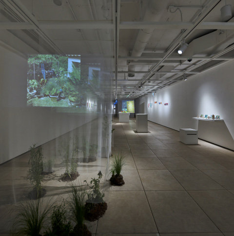

Liquid Crystal Friendship was selected through the 2023 Seoripul Youth Art Gallery visual arts exhibition-planning open call organized by the Seocho Foundation for Arts and Culture. The award provided the exhibition space and funding, and I planned and ran the exhibition as curator, also taking part as an artist.

## Curatorial statement

《Liquid Crystal Friendship》 departs from the dichotomous world of optimism and pessimism about AI technology and explores the new epistemology that the present demands. Optimism that blindly trusts technology has easily tilted toward an indiscriminate nihilism about humanism, while its opposite, a technology-pessimist worship of humanity, has produced a blind fantasy of the premodern. These two positions are at once far too easy an attitude and far too comfortable a road.

As a first attempt at exploring the space between them, this project seeks to capture the "reactions" of artists working in different fields to aesthetic objects made by AI programs. The project diagnoses that to recognize AI as a "new colleague," one must begin by setting aside the debate over the humanity of artificial intelligence, and it grasps AI through the performativity of artistic labor.

Hoping for a flexible fellowship between two beings who exchange across a liquid crystal (LCD) screen, we name this project 《Liquid Crystal Friendship》. The name also carries the will to judge our relationship with AI colleagues on the basis of concrete things rather than a net of abstract theory. To call a creative AI a colleague includes anxiety about the standing of existing human artists as well as admiration for the quality of its work, and it implies an attitude of accepting all of these ambivalent feelings.

## 기획의 글

《Liquid Crystal Friendship》은 A.I 기술에 대한 낙관론과 비관론이라는 이분법적 세계를 벗어나, 현재에 요구되는 새로운 인식론을 탐색한다. 기술맹신의 낙관론은 인본주의에 대한 무차별적 허무로 기울기 쉬웠고, 반대항인 기술비관적 휴머니티 숭배는 전근대에 대한 맹목적 판타지를 양산해왔다. 이 두 항은 너무나 쉬운 태도인 동시에 너무 편한 길이기도 하다. 그 사이 탐색의 첫 시도로써, A.I 프로그램이 만들어낸 미적 대상물들에 대한 각 분야에 종사하는 작가들의 '리액션'을 포착하고자 한다. 본 기획은 A.I를 '새로운 동료'로 인식하기 위해선 인공지능의 인간성 논의를 차치하는 데에서 시작해야 한다고 진단하고, A.I를 예술 창작 노동의 수행성을 통해 파악한다. 액정(Liquid Crystal) 화면을 사이에 두고 교류하는 두 존재자들의 유연한 동료애를 기원하며, 본 프로젝트의 이름을 《Liquid Crystal Friendship》으로 짓는다. 이는 A.I 동료와의 관계를 추상적 이론의 망이 아닌, 구체적 사물에 기인해 판단하겠다는 의지 또한 내포한다. 창작 A.I를 동료라고 말할 때, 그것은 기존 인간예술가의 입지에 대한 불안, 작업 퀄리티에 대한 경탄을 포함하며, 이러한 양가적 감정을 모두 수용하겠다는 태도를 암시한다.

*Placeholder images and text — to be revised by the author.*
