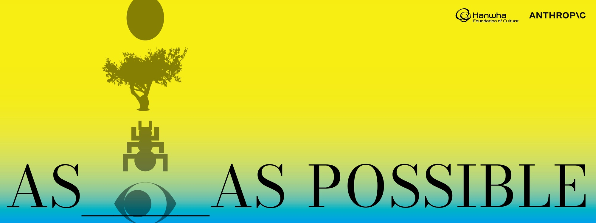

AS _____ AS POSSIBLE was the Hanwha × Anthropic Art Commission 2026 exhibition at Centre Pompidou Hanwha, organized by the Hanwha Foundation of Culture and curated by Jieun Seo. It ran from 23 October to 13 November 2026 on the ground floor and first floor. Five artists and collectives (MinOhrichar, Inhwa Yeom, Ubac Studio, Kahee Jeong and Mirim Chu) made works around interpretability, which asks how AI systems work, and alignment, which asks how to make them act in line with human intentions and values. The exhibition was launched to coincide with Research Salon Seoul, co-hosted by the Hanwha Foundation of Culture and Anthropic.

Inhwa Yeom is a media artist and engineering researcher whose work combines AI, XR, biotechnology, interactive systems and performance. Her work asks audiences to take part with their cognition, psychology and bodies, and builds devices and environments that act like stages for that experience. Her piece in the show, Chandra Chronicles: In Neuroverse (찬드라 연대기: 인 뉴로버스, 2025–26), is an XR installation made of AI-based interactive video, mobile AR, an assistive walker, crystal, resin and sound.

I took part as AI researcher through the studio Biove. I designed and implemented the AI architecture for the work.
